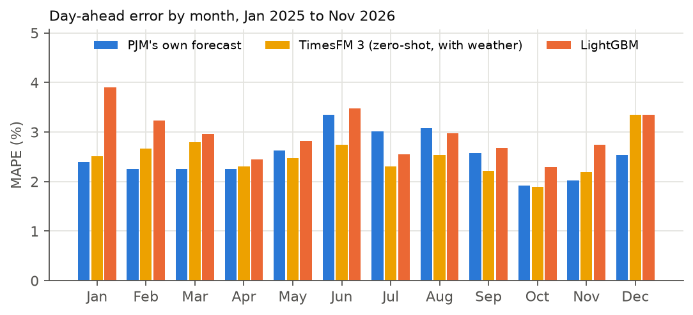
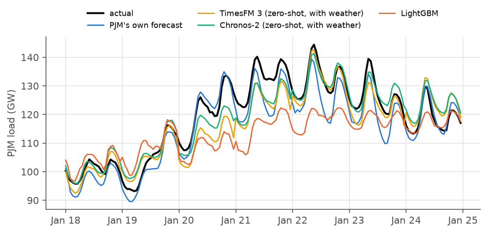

# grid-forecast

[](https://github.com/vajralakushal/grid-forecast/actions/workflows/ci.yml)

Day-ahead electricity demand forecasts for **PJM**, the largest US grid operator (all or parts of 13 states plus DC, including Chicago), tested against PJM's own published forecast on 678 days, using only free public data.

## Result

A pretrained time-series model, **Google's TimesFM 3.0, used zero-shot** (never trained on PJM data) and given 2-day-ahead weather forecasts, **matches PJM's own day-ahead forecast**:

| Jan 2025 to Nov 2026, 16,207 hours | MAPE | daily peak error | 80% interval coverage |
|---|---|---|---|
| PJM's own forecast | 2.54% | **1.87%** | n/a (not published) |
| TimesFM 3, zero-shot, with weather | **2.47%** | 2.74% | 82.4% |
| LightGBM, trained on our data | 2.94% | 3.28% | 54.6% |
| Copy last week (baseline) | 8.59% | 9.24% | 80.4% |

- **The overall gap is not statistically significant.** The 95% interval for TimesFM's daily MAPE minus PJM's is −0.26 to +0.10 points (Diebold–Mariano p = 0.44).
- **TimesFM is significantly better in summer** (June–August, by 0.62 points a day, p = 0.001) and **worse in winter** (December–February, by 0.37 points, p = 0.051). The summer edge holds up under Hansen's SPA test, which corrects for having picked the best of 11 models (p = 0.001). Overall, the SPA test finds no model that beats PJM (p = 0.23).
- **PJM forecasts the daily peak much better**, at 1.87% error vs. TimesFM's 2.74%.
- **No sign of training-data leakage:** on the 70 days after TimesFM 3's release, which cannot be in its training data, it scores 1.89% vs. PJM's 2.26%.



## How the test works

Every model makes the forecast PJM makes. At **10:00 Eastern on day D-1**, it forecasts **each hour of day D** (14 to 37 hours ahead). The backtest replays this for every day from January 1, 2025, and enforces three rules in one shared harness (`src/gridfc/harness.py`):

1. **Demand only up to 08:00 on D-1.** Meter data arrives with a delay, so the last two hours before the forecast are hidden.
2. **Weather only from forecasts made about 2 days ahead.** Actual weather is never a model input, because nobody knows tomorrow's actual temperature at 10 am. `harness.allowed_features()` enforces this, and tests check it.
3. **Training only on data from before each forecast.** Models retrain as the replay moves forward. Training LightGBM on all data and scoring it on the same hours gives 1.36% MAPE instead of 2.94%, which shows how much a leaky test flatters a model.

PJM's forecast as published in EIA-930 is labeled one hour early (it scores 3.48% as published, 2.54% shifted). The benchmark uses the shifted, harder-to-beat version.

## Where PJM still wins

On cold snaps and holidays. During the January 2025 cold snap, load peaked at 144.4 GW. TimesFM forecast 142.6 GW, PJM 139.3 GW, and LightGBM 122.3 GW. LightGBM fails because trees cannot forecast past the coldest day in their training data.



## Models

All run through the same harness, on the same hours.

| Model | Family | MAPE |
|---|---|---|
| `timesfm3` | Google TimesFM 3.0, pretrained, zero-shot, with weather | 2.47% |
| `lgbm_linear` | LightGBM with a linear model in each leaf | 2.93% |
| `lgbm` | LightGBM, 7 quantiles + mean, retrained every 30 days | 2.94% |
| `chronos2` | Amazon Chronos-2, pretrained, zero-shot, with weather | 3.08% |
| `linear` | Ridge regression per hour on heating and cooling degree-hours | 3.25% |
| `timesfm3_uni`, `chronos2_uni` | The pretrained models without weather inputs | 4.82%, 4.89% |
| `prophet` | Prophet with degree-hour regressors | 5.87% |
| `mstl` | Seasonal decomposition + exponential smoothing, no weather | 6.14% |
| `weekly_naive` | Same hour last week | 8.59% |

Weather inputs matter more than the choice of model. Without them, the pretrained models score about 4.8–4.9%.

## Data

All free and public, so anyone can reproduce every number.

| Source | What | Since | Key |
|---|---|---|---|
| [EIA-930](https://www.eia.gov/opendata/) (EIA API v2) | PJM hourly demand, PJM's day-ahead forecast, 20 subregions | 2019 | free API key |
| [Open-Meteo](https://open-meteo.com/) Previous Runs API | 1- and 2-day-ahead weather forecasts, 10 PJM cities | Jan 2024 | none |
| Open-Meteo Archive (ERA5) | Observed weather, for exploration only | 2015 | none |

Weather is averaged across 10 cities, weighted by each subregion's load. A GitHub Action also saves the daily ECMWF and NOAA ensemble weather forecasts to monthly Releases (`ensemble-YYYY-MM`).

## Reproduce

Needs [uv](https://docs.astral.sh/uv/) and a free [EIA API key](https://www.eia.gov/opendata/register.php). Tested on macOS (Apple silicon, 10 cores) and Ubuntu (CI).

```bash
cp .env.example .env                    # paste your EIA key into .env
uv sync                                 # installs everything, including CPU torch
uv run python -m gridfc.fetch_eia       # ~5-15 min the first time
uv run python -m gridfc.fetch_weather   # ~5 min
uv run python -m gridfc.clean           # screen bad values -> data/clean/
uv run python -m gridfc.backtest --model all          # every model + PJM benchmark
uv run python -m gridfc.report          # comparison table on common hours
uv run python scripts/readme_figures.py # the figures above
uv run pytest                           # offline tests, no data needed
```

`backtest --model all` runs every model one after another, which takes a few hours. To run them in parallel, start one process per model with `--model NAME --no-benchmark`. All 8 newer models took about 18 minutes side by side on a 10-core Mac. The pretrained models download their weights from Hugging Face on first use, and run on CPU.

Data lands in `data/` (gitignored). Numbers will shift slightly with later EIA revisions and a longer test period.

## Layout

```
src/gridfc/
  fetch_eia.py, fetch_weather.py, collect_ensemble.py   downloads
  clean.py                  screening, PJM forecast alignment, weather weighting
  harness.py                the backtest rules every model goes through
  metrics.py                MAPE, pinball, coverage, peak metrics, significance tests
  models/                   baselines, gbm, linear, stats, prophet_model, pretrained
  backtest.py, report.py    run models, compare on common hours
scripts/readme_figures.py   README figures
tests/                      offline tests (fake data, stand-in models)
```

## Tests

20 offline tests run on every push (CI badge above). They check, among other things:

- No model ever sees demand after the cutoff, observed weather, or PJM's forecast.
- Forecast features are identical whether or not future data exists.
- The linear model forecasts higher load for a day colder than any training day.
- Quantile columns map correctly from each pretrained model.
- The significance tests (Diebold–Mariano, bootstrap, SPA) detect a known gap and ignore pure noise.

## Limitations

- **One test period, many models.** Picking the best of many models on the same hours flatters the winner. A live forecast, saved before the actual load arrives, is the clean test, and it's next.
- **The pretrained models' training data is unknown.** The post-release check argues against leakage, but it covers only 70 autumn days.
- **One weather average for all of PJM.** PJM uses many weather stations per zone. Per-zone weather is the most likely next gain.
- **TimesFM 3.0 weights are licensed for non-commercial use only.** Chronos-2 is Apache 2.0.

## Next

- A daily live forecast from GitHub Actions, published with its scores as they come in.
- More weather inputs (humidity, precipitation, snowfall, pressure) and holiday types for the pretrained models.
- Training forecast-weather models on NOAA GFS forecasts back to 2021, to cover more cold snaps.

## License

Code: MIT (see `LICENSE`). Data and model weights keep their own terms (see Credits).

## Credits

Demand data from the U.S. Energy Information Administration (EIA-930). Weather data from [Open-Meteo.com](https://open-meteo.com/) (CC BY 4.0). Models: [TimesFM](https://github.com/google-research/timesfm) (Google Research), [Chronos](https://github.com/amazon-science/chronos-forecasting) (Amazon), [LightGBM](https://github.com/microsoft/LightGBM), [statsforecast](https://github.com/Nixtla/statsforecast), [Prophet](https://github.com/facebook/prophet).
